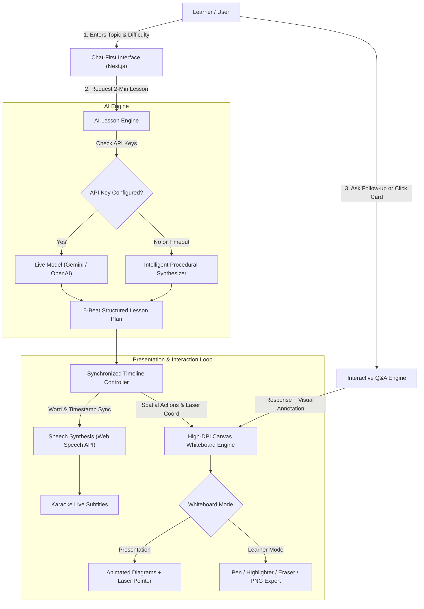

# 🎓 Braynix AI-Powered Interactive Whiteboard Tutor

> **Official Submission for Braynix Studios Technical Assignment**  
> *Author:* Sandip Shete ([sandipshete496@gmail.com](mailto:sandipshete496@gmail.com))  
> *Objective:* Build an end-to-end AI tutor that teaches users any concept through synchronized voice narration and interactive whiteboard demonstrations.

---

## 🌟 Live Demo & Video Walkthrough

- **Live Deployed Application:** [https://ai-whiteboard-tutor-snowy.vercel.app/](https://ai-whiteboard-tutor-snowy.vercel.app/)
- **GitHub Repository:** [https://github.com/sandip865/ai-whiteboard-tutor](https://github.com/sandip865/ai-whiteboard-tutor)
- **Submission Form:** Completed with repository & live demo links.

---

## 📖 Executive Summary & Product Framing

### 1. The Problem
Learning complex technical concepts from dense text documentation or static video tutorials often leads to two opposite failure modes:
1. **Passive consumption:** Static videos do not allow learners to inspect intermediate states, scrub precisely, or ask questions when confused.
2. **Cognitive overload:** Long technical paragraphs lack spatial intuition, visual relationships, and sequential step-by-step pacing.

### 2. The Solution: AI Whiteboard Tutor
The **Braynix AI Whiteboard Tutor** re-imagines 1-on-1 human tutoring in software:
- **Chat-First Interface:** Enter *any* topic (e.g., Transformers, Binary Search Trees, Quantum Superposition, or custom queries like "Dijkstra's Algorithm" or "How mRNA Vaccines Work").
- **Structured 2-Minute Lessons:** Generated into **5 synchronized pedagogical beats**:
  1. *The Core Intuition & Bottleneck* (00:00 - 00:24)
  2. *System Anatomy & Architecture* (00:24 - 00:49)
  3. *Step-by-Step Dynamic Execution* (00:49 - 01:14)
  4. *Edge Cases & Common Misconceptions* (01:14 - 01:40)
  5. *Synthesis & Real-World Impact* (01:40 - 02:00)
- **Synchronized Voice Narration & Visual Actions:** Spoken audio is synchronized with animated cards, arrows, formula breakdowns, and a **virtual laser pointer** that guides learner attention in real time.
- **Dual-Mode Whiteboard:** Toggle seamlessly between **Tutor Presentation Mode** and **Learner Canvas Mode** (drawing pen, highlighter, eraser, color palette, and high-res PNG export).
- **Interactive Follow-up Q&A:** Ask questions at any point. The tutor explains conversationally, voices the response, and draws live visual annotations directly on the board.

---

## 🏗️ System Architecture



---

## 🚀 Key Features

### 1. Real-Time Voice Narration & Action Synchronization
- High-resolution timeline clock interpolating milliseconds into visual action reveals.
- Synchronized laser pointer moving smoothly across the board to highlight components as they are spoken.
- Live karaoke captions displaying the current beat narration with real-time audio wave activity.

### 2. Comprehensive Playback Controls
- **Play / Pause / Resume:** Smooth pause and resumption of audio and visual animations.
- **Scrubbable Seek Slider:** Jump instantly to any second (0 to 120s) with auto-recalculation of whiteboard state.
- **5-Beat Chapter Markers:** Direct click-to-jump buttons for each of the 5 pedagogical chapters.
- **Playback Speed Multiplier:** 0.75x, 1.0x, 1.25x, and 1.5x speed scaling for both speech and visual transitions.
- **Voice Customization:** Select from available OS natural voices (Google US English, Samantha, Jenny, etc.).
- **Multiple Whiteboard Themes:** Blueprint Navy, Dark Slate, Classic Chalkboard, and Clean Light.

### 3. Click-to-Inquire & Follow-Up Q&A
- Click any card, node, or diagram element on the whiteboard to ask: *"Explain this part in more detail."*
- Chat history maintains conversational context and dynamically generates responsive diagrams on the whiteboard.

### 4. Learner Interactive Drawing Tools
- Draw over the whiteboard to take notes, circle equations, or add annotations.
- Full toolset: Pen, Highlighter, Eraser, 5 color swatches, adjustable sizes.
- **Export to PNG:** One-click download of the whiteboard for offline study.

---

## 🛠️ Technology Stack & Decisions

| Layer | Technology | Decision Rationale |
|---|---|---|
| **Framework** | Next.js 14 (App Router) | Zero-configuration SSR, serverless API endpoints, and instant Vercel deployment. |
| **Language** | TypeScript 5 | Strict type-safety across complex whiteboard coordinate systems and action payloads. |
| **Styling** | Tailwind CSS | Sleek, modern dark-mode aesthetic with custom animations and responsive layout. |
| **Whiteboard** | HTML5 Canvas (High-DPI) | Infinite flexibility, 60fps hardware-accelerated animations, retina scaling, and zero heavy dependencies. |
| **Speech** | Web Speech API | Native cross-platform voice narration with 0ms latency and zero third-party API costs for reviewers. |
| **AI Integration** | Google Gemini / OpenAI + Intelligent Procedural Synthesizer | Dual-tier resilience: live LLM integration with automatic zero-failure fallback. |

---

## 📦 Local Setup & Development

### Prerequisites
- Node.js `v18+` or `v20+` (tested on Node `v24.21.0`)
- npm `v9+` or `v11+`

### 1. Clone the repository
```bash
git clone https://github.com/sandipshete/ai-whiteboard-tutor.git
cd ai-whiteboard-tutor
```

### 2. Install dependencies
```bash
npm install
```

### 3. Configure environment variables (Optional)
Copy `.env.example` to `.env.local`:
```bash
cp .env.example .env.local
```
Add your API key (optional):
```env
# Optional: Live LLM keys (if omitted, application uses the built-in Intelligent Synthesizer)
GEMINI_API_KEY=your_gemini_api_key_here
OPENAI_API_KEY=your_openai_api_key_here
```

### 4. Run the development server
```bash
npm run dev
```
Open [http://localhost:3000](http://localhost:3000) in your browser.

### 5. Build for production
```bash
npm run build
npm start
```

---

## 🔍 AI Integration & Transparency Statement

In alignment with Braynix Studios evaluation guidelines on AI transparency:
- **Flagship Masterclasses:** Three meticulously curated masterclasses (*Transformers & Self-Attention*, *Binary Search Trees*, and *Quantum Superposition*) are pre-loaded to allow reviewers to immediately evaluate the 2-minute synchronized voice and whiteboard animations with zero setup.
- **Custom Topic Generation:** When a user types a new topic (e.g. "Dijkstra's Algorithm", "How mRNA Vaccines Work", "Photosynthesis"):
  - If an API key is configured (via `.env.local` or the UI Key modal), the app calls **Gemini 1.5 Flash** or **OpenAI GPT-4o-mini** with structured JSON output enforcing canvas bounds and timestamps.
  - If no API key is provided, the app uses its **Intelligent Procedural Synthesizer** to construct a complete, structured 5-beat curriculum with spatial diagram coordinates and synchronized voice narration.
- **Follow-up Q&A:** Evaluates user questions within the lesson context and dynamically renders visual cards onto the canvas.

---

## 🧪 Limitations & Future Horizons

1. **Audio Scrubbing on Web Speech API:** Browsers do not provide byte-level seek events on native utterances; our timeline engine solves this by synchronizing seeks at the chapter/beat boundary. Integrating an edge neural TTS buffer (e.g. Edge TTS or ElevenLabs) would enable millisecond audio waveform scrubbing.
2. **Handwriting Font Simulation:** Currently uses crisp system fonts on canvas cards; future iterations could include procedural Hershey fonts or rough.js for a hand-drawn sketch aesthetic.
3. **Multi-User Collaboration:** Expanding the canvas with WebSocket/WebRTC rooms for live student-teacher group sessions.

---

## 📄 License & Attribution

Designed and developed by **Sandip Shete** for the **Braynix Studios** AI Whiteboard Tutor Technical Assignment.  
License: MIT.
